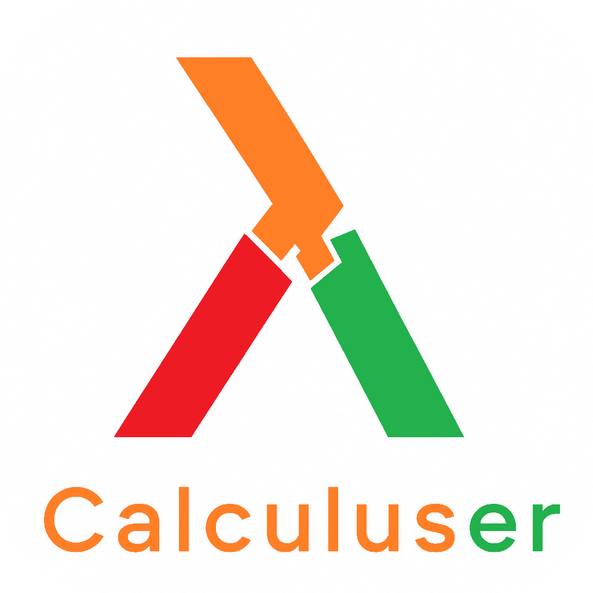

# Calculuser

<div align="center">
  
</div>

一款基于渐进式类型 λ 演算（Gradual Typing Lambda Calculus）与组合子逻辑（Combinatory Logic, SKI）的逻辑构造与推演解谜类游戏。玩家在工坊中装配组合子与 λ 抽象装置，通过信号喂入与归约完成各章节来客的委托。支持 Web 端与 Windows 桌面端运行。

游戏中的所有装置均严格遵循 α-等价、β-归约与类型一致性规则，并非黑盒脚本。从基础的 I、K、S
组合子起步，经由布尔逻辑、邱奇数、不动点递归到带类型标注的零件装配与自由沙盒推演，所有高级构件均由基础零件逐层封装而成。

## 同行的码

本作围绕「同行」主题展开双重释义：

- 一行流：函数式编程推崇克制而优雅的一行流表达式，不依赖冗余的多行语句或状态变更，仅借由表达式的复合传递语义；而在一切函数式语言的源头 λ 演算中，这种极简被推向极致——无需分支关键字或显式循环，仅凭**同一行**纯函数表达式的嵌套与归约，便足以构造布尔、算术、代数数据类型乃至不动点递归，将整座计算世界浓缩于一行之中。
- 并肩同行：玩家在绘图室中与助手机械臂「小丘」协作，前序关卡封装的装置也会成为后续关卡的基石零件，伴随玩家一同走完从 `I`/`K`/`S` 到奇异点递归的旅程。

## 核心玩法与模式

游戏目前共包含 **7 个章节、82 个关卡**，以及独立的自由实验台，内容覆盖从基础组合子到序对（积类型）、和类型、邱奇数、列表、二叉树及 `Y` / `Θ` 不动点递归的完整构造体系：

- **构建订单（build）**：使用基础组合子（`I`、`K`、`S`）及已解锁装置进行拼接、开槽抽象（`λ`）与喂入推导（Apply），满足全部输入输出测试用例，并可冲击精简零件数（Par）三星评价。
- **类型契约（typebuild）**：分布在第 2 至第 7 章，共 15 关。在构建等价计算逻辑的同时，须满足渐进类型 λ 演算（GTLC）的目标类型签名与显式参数类型标注要求。
- **试机推演（run）**：观察表达式的单步或连续 δ/β-归约过程、信号拷贝次数与纸带时间轴变化，理解惰性求值与组合子展开机制。
- **自由实验台（sandbox）**：无关卡约束的组合项装配台，支持自由拼装、自定义装置注册与归约观察。

## 主要功能

- **可视化工作台**：支持画布拖拽平移、滚轮/按键缩放、聚焦画布、透视模式（查看底层展开结构）、De Bruijn 作用域信号珠填入、操作撤销及纸带时间轴步退/步进。
- **渐进类型系统**：内置类型解析、箭头参数拆解、类型一致性与精度判定、类型标注及纯组合子校验。
- **演算学习辅助**：通过直观的装置封装、逐层展开透视与分步归约回放，辅助理解和学习 λ 演算、SKI 组合子逻辑、代数数据类型编码及类型理论基础。
- **剧情与图鉴系统**：包含开场独白与多分支接待台对话、装置图鉴、章节总览地图及 7 项成就记录。

## 技术栈

- 前端：TypeScript、SolidJS、Vite（支持 `vite-plugin-singlefile` 单文件构建）
- 桌面端：Tauri v2、Rust
- 工具链：Bun、Biome（格式化与静态检查）、Vitest（单元测试）、Lefthook（Git pre-commit 钩子）

### 开发与构建

前置环境：Node.js / Bun；若需构建桌面端，另需 Rust 工具链。

```bash
bun install
bun run dev
bun run build
bun run tauri:dev
bun run tauri:build
bun run tauri:build:portable
```

### 校验与测试

```bash
bun run check
bun run lint
bun run format
bun test
```

## 开源协议

本项目采用 [GPL-3.0](LICENSE) 开源协议。
